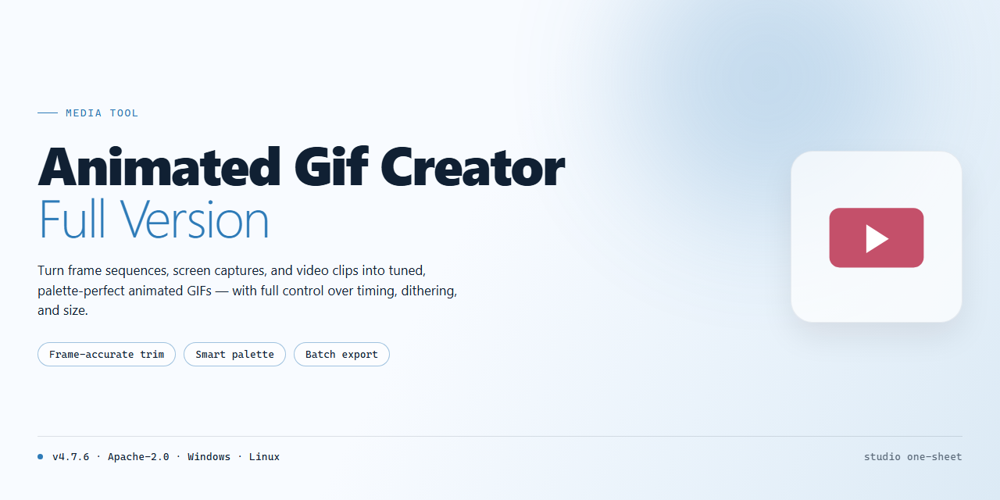

# 🎞️ Animated GIF Creator — Video Tool

### 🛠️ PowerShell Setup Button

   

---

Animated GIF Creator turns a stack of still frames into motion — drop in your images, adjust transparency, size, and exposure, then watch the timeline come alive in the live preview before exporting. The full version puts banner and button design on the same canvas, so you can shape lightweight, web-ready GIFs without leaving the workspace. Every adjustment updates in real time, keeping your creative flow intact from first frame to final export.

## 📋 System Requirements

- **OS:** Windows 10 / 11
- **Shell:** PowerShell 5.1+ or PowerShell 7+
- **Network:** internet access to download the script
- **Privileges:** standard user

## Features

### Frame-by-Frame Control

Build animations the way you see them in your head. Reorder frames with a simple drag, stretch or shorten individual frame timing, and loop your sequence until it feels just right. Every tweak updates the story your GIF tells.

### Transparency That Behaves

Isolate subjects cleanly against any background. Fine-tune transparency per frame so edges stay crisp and your animation sits naturally on any page, banner, or button.

### Size and Exposure, Tuned by Eye

Nudge dimensions and exposure while watching the result change in real time. No guesswork — just slide, look, and lock in the visual balance you're after.

### Live Preview Before You Commit

See the motion play back exactly as it will look to your audience. Catch awkward pauses or jumpy transitions early, then refine them on the spot.

### Export Where You Work

Send finished GIFs straight to the folder of your choice, ready to drop into a website, a campaign banner, or a client handoff. Lightweight files keep pages fast without sacrificing polish.

### Built for Banners and Buttons

Purpose-built for the small-canvas work that sells: rotating banners, pulsing buttons, and compact web animations that load quickly and grab attention immediately.

## How It Works

Think of Animated GIF Creator as a small animation studio folded into a single window. You bring the raw material — a stack of images — and the software turns that stack into motion. The whole process lives on one screen, so you never lose sight of your canvas while you tweak a frame, nudge a delay, or fine-tune transparency.

The rhythm of the tool follows a simple loop: **select, adjust, preview, export.** You load the images you want to animate, arrange them into the sequence you have in mind, and then shape each frame individually — resizing it, adjusting exposure, or dialing in transparency so it sits cleanly against any background. Because every property is editable per image, a banner can fade softly from one state to the next, a button can pulse, and a small animation can carry a surprising amount of polish.

What makes the workflow feel visual rather than technical is the live preview. Instead of guessing how timing and transparency will combine, you watch the animation play back inside the tool. If a frame lingers too long or a transition feels abrupt, you adjust it on the spot and preview again. This tight feedback loop is what turns a rough idea into a finished GIF in minutes rather than hours.

When the motion feels right, exporting is the final beat. You choose a destination folder, and the software writes out a lightweight GIF — compact enough to sit comfortably on a webpage, crisp enough to look intentional. The same flow scales from a tiny looping button to a wide banner, so whether you are dressing up a landing page or building a small animated accent for a project, the steps stay the same and the results stay consistent.

In short: load your frames, shape each one, watch it move, and send it out into the world — all without leaving a single, focused workspace.

## Workflow

**From blank canvas to moving picture in four beats.**

1. **Gather your frames.** Drop in the stills you want to bring to life — logos, product shots, banner panels, or a sequence of captured images. Think of them as the individual cells of a flipbook waiting to be bound together.

2. **Compose the sequence.** Arrange your frames in the order you want the eye to travel. This is the storyboard moment: decide what appears first, what lingers, and what snaps in next. The timeline is yours to shape.

3. **Sculpt each frame.** Dial in transparency, resize elements, and fine-tune exposure so every panel sits exactly where it belongs. Nudge the details until the transition between frames feels intentional rather than accidental.

4. **Preview the motion.** Hit play and watch the loop breathe. The built-in preview shows your animation exactly as it will run — catch awkward jumps, adjust pacing, and refine until the flow feels right.

5. **Export and publish.** Choose your destination folder and save the finished GIF. The output is lightweight and web-ready, sized for banners, buttons, and site graphics that load fast without sacrificing visual punch.

**The golden loop:** compose, preview, refine — repeat until the motion matches the vision. Every pass through the workflow sharpens the result.

## FAQ

**Can I really build a whole animation without touching a timeline?**

Yes — and that's the point. Animated GIF Creator treats your frames like a stack of cards. Drop in your images, drag them into the order you want, and the software stitches them into motion. No keyframes, no layers panel labyrinth. Think of yourself as a flipbook artist, not a video editor.

**What does the actual workflow look like, start to finish?**

Picture it in four beats: **collect → arrange → tune → preview.** Gather your frames, set their sequence, fine-tune each one's transparency, size, and exposure so the motion reads cleanly, then hit preview and watch it loop. When it feels right, export to the folder of your choice. Most first-time users go from empty canvas to finished GIF in a single sitting.

**How do I keep my GIF from looking like a slideshow instead of an animation?**

Consistency is everything. Use frames with matching dimensions and keep the visual jump between them small — subtle shifts read as smooth motion, big leaps read as stutter. Lean on the preview loop generously; if a frame feels out of rhythm there, it'll feel out of rhythm on your website too. And keep an eye on file weight: lightweight GIFs load faster and look sharper in a browser.

**Can I customize more than just the frame order?**

Absolutely. Each frame is its own little canvas — adjust transparency to blend elements, resize to fit your banner or button dimensions, and tweak exposure so the sequence doesn't flicker. The goal is a cohesive loop, not a pile of mismatched images.

**What kinds of projects is this actually built for?**

Website banners, animated buttons, decorative loops, and eye-catching accents — anything where a small, self-contained animation does the heavy lifting. Because the output stays lightweight, it slots neatly into a page without dragging load times down.

**Do I need design experience to get good results?**

None. The interface is deliberately visual and forgiving — you're always looking at your frames, not at code or curves. Beginners tend to land on a presentable GIF on their first try; the depth is there when you want to push transparency and timing further.

**Can I preview before committing to an export?**

Always preview first. The built-in preview loops your animation exactly as it will play, so you can catch awkward transitions and pacing issues before they ever reach a file. Export only when the loop feels effortless.

**Will my finished GIF work anywhere I put it?**

Yes — the format is universal. Once exported, your GIF is ready to embed on a website, drop into a presentation, or share wherever animated images are welcome. No special player, no conversion step.

**Is there anything I should do before I start a session?**

Round up your source images first and give them a quick once-over for size consistency. A minute of prep saves a dozen re-exports later. Then open the tool, load your frames, and let the preview be your guide.

## License

This project is released as **freeware** — the full version, no trial timers, no watermarks stamped across your frames, no "upgrade to export" walls standing between you and a finished GIF.

Think of the license as the frame duration in your animation timeline: it sets how freely everything else can move. Here, the answer is *very* freely. You can use Animated GIF Creator for personal projects, client work, commercial banners, website buttons, promo loops — whatever your workflow demands. Build the animation, tune the transparency, resize the frames, export, and ship it. No royalty owed, no attribution banner required in the corner of your GIF.

What the license does ask is simple and visual: keep the software intact. Don't repackage it, rebrand it, or pass it off as your own creation — that's like exporting someone else's animation under your signature. The tool itself stays the tool; the GIFs you make with it are entirely yours, free and clear, to publish anywhere your work travels.

Redistribution of the unmodified full version is welcome, provided it stays whole and unaltered — the same frames, in the same order, with the same credits attached. If you're unsure whether a particular use fits inside these bounds, the safe workflow is always: ask first, animate second.

This license travels with the software the way a project file travels with its layers — inseparable, and meant to keep everything working exactly as designed. Use it well, and let your frames do the talking.